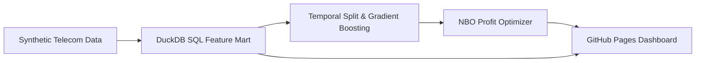

# Telecom Churn & Next Best Offer

Портфельный MVP для команды Data Science телеком-оператора. Пайплайн создаёт панель из 300 000 наблюдений по 50 000 абонентов, прогнозирует отток на следующий месяц и назначает оффер, если ожидаемая маржа после затрат положительна.

[Live Dashboard](https://dark-ak06.github.io/telecom-churn-nbo/) · [Model Card](MODEL_CARD.md)

## Бизнес-эффект MVP

На сентябрьском срезе с исходами за октябрь 2026 года ML NBO назначил оффер 11 351 из 50 000 абонентов. На синтетическом holdout оценка оттока снизилась на **2,94 п. п.**, чистый эффект за три месяца составил **+12,69 млн ₸**, ROI кампании — **238,1%**. 95%-й интервал чистого эффекта ML NBO составляет от 9,45 до 15,94 млн ₸.

| Стратегия | Оценка оттока | Затраты | Чистый эффект к контролю | ROI |
| --- | ---: | ---: | ---: | ---: |
| Без действий | 20,55% | 0 ₸ | 0 ₸ | — |
| Массовая скидка | 18,35% | 28,58 млн ₸ | −18,43 млн ₸ | −64,5% |
| ML NBO | 17,61% | 5,33 млн ₸ | +12,69 млн ₸ | 238,1% |

Для финансовой оценки применяется маржинальность 60–70% от ARPU в зависимости от тарифа. Контакт стоит 75 ₸, стоимость скидки или пакета начисляется при принятии оффера независимо от дальнейшего оттока. Трёхмесячная маржа удержанного абонента рассчитана при постоянном ARPU. Для переноса результата в кампанию нужен эксперимент с глобальной контрольной группой.

Наблюдаемый отток при рандомизированных назначениях составил **19,67%**. HistGradientBoosting достиг **ROC-AUC 0,850**, **PR-AUC 0,690** и **Lift@10% 4,13×**. Среди 5 000 абонентов с наибольшим риском было 4 057 случаев оттока, или 41,26% всех тестовых случаев.

## Архитектура



SQL строит признаки из закрытого месяца и более ранней истории. Логистическая регрессия служит базовой моделью, бустинг учитывает нелинейные сочетания признаков. NBO моделирует риск оттока для каждого назначения и вероятность принятия коммерческих офферов. Стоимость скидки привязана к ARPU, стоимость пакетов фиксирована.

## Запуск

В активном окружении Python 3.11 выполните две команды из корня проекта.

```bash
python -m pip install -r requirements.txt
python -m src.run_pipeline
```

Пайплайн использует seed 42 и по умолчанию воспроизводит аудит с датой среза 19 ноября 2026 года. Месяцы наблюдений идут с апреля по сентябрь, отток для последнего среза измеряется в октябре. Аргумент `--as-of YYYY-MM-DD` сдвигает окно. В него входят шесть месяцев наблюдений, для которых уже закрыт следующий месяц с исходами.

| Результат | Файл |
| --- | --- |
| Синтетическая панель | `data/raw/telecom_usage.parquet` |
| SQL-витрина | `data/processed/feature_mart.parquet` |
| EDA по тарифам, регионам, месяцам и RFM | `artifacts/eda_summary.json` |
| Метрики и кривые двух моделей | `artifacts/model_metrics.json` |
| Лучшая модель | `artifacts/churn_model.joblib` |
| Сравнение политик удержания | `artifacts/nbo_simulation.json` |
| Интерактивный дашборд | `docs/index.html` |

HTML можно открыть локально. Для интерактивных графиков браузеру нужен доступ к CDN Plotly. Для автоматического деплоя выберите **GitHub Actions** в **Settings → Pages → Source**. Пуш в `main` запускает проверки, полную сборку и публикацию `docs/`. Pull request запускает проверки и сборку. [Документация GitHub Pages](https://docs.github.com/en/pages/getting-started-with-github-pages/using-custom-workflows-with-github-pages)
